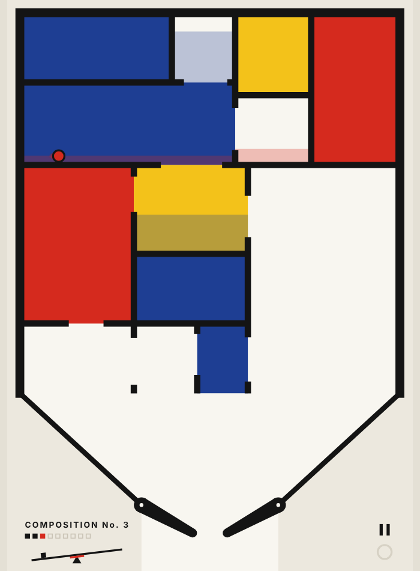

# Counterweight

A two-button pinball game played on a painting. Made for [Game Off 2026](https://itch.io/jam/game-off-2026) — theme: **SHIFT**.

The only controls are the two Shift keys. Bounce the ball off the colour blocks, let it paint the white cells, and turn the whole painting when you need a new angle. Nine compositions, then your collection — which you can sign and save as an image.

## Controls

| Key | Action |
|---|---|
| Left Shift | Left flipper |
| Right Shift | Right flipper |
| Hold both Shifts | Turn the painting 90° (gravity turns with it) |
| Esc | Pause: resume, restart, sound on/off, quit |

`Z` and `/` also work as flippers, as does tapping the left or right half of the screen.

**Windows:** pressing Shift five times in a row opens the Sticky Keys prompt. Choose "No", or turn the shortcut off in Settings → Accessibility → Keyboard, or play with `Z` and `/`.

## How SHIFT is used

- The Shift keys are the entire control scheme.
- Holding both shifts the painting a quarter turn, which shifts gravity and the table layout.
- Every stroke of paint shifts the composition's weight.

## Design notes

How the hidden balance works, why blue, red and yellow weigh what they do, how the difficulty curve was tuned, and what was tried and cut along the way: **[docs/BALANCING.md](docs/BALANCING.md)**.

## Run it

It is a single file with no build step and no dependencies. Open `index.html` in a browser.

## Tech

Plain HTML canvas and JavaScript. Custom physics (720 Hz substeps), procedurally generated compositions, and all sound synthesized with the Web Audio API — there are no image or audio assets. The typeface is [Jost](https://fonts.google.com/specimen/Jost) (SIL Open Font License), loaded from Google Fonts.

## Credits

Design by Ellie Huang. Code written with Claude (Anthropic).
Visual style inspired by De Stijl and Piet Mondrian. Every composition in the game is generated; none reproduces an existing artwork.

## License

MIT — see `LICENSE`.
